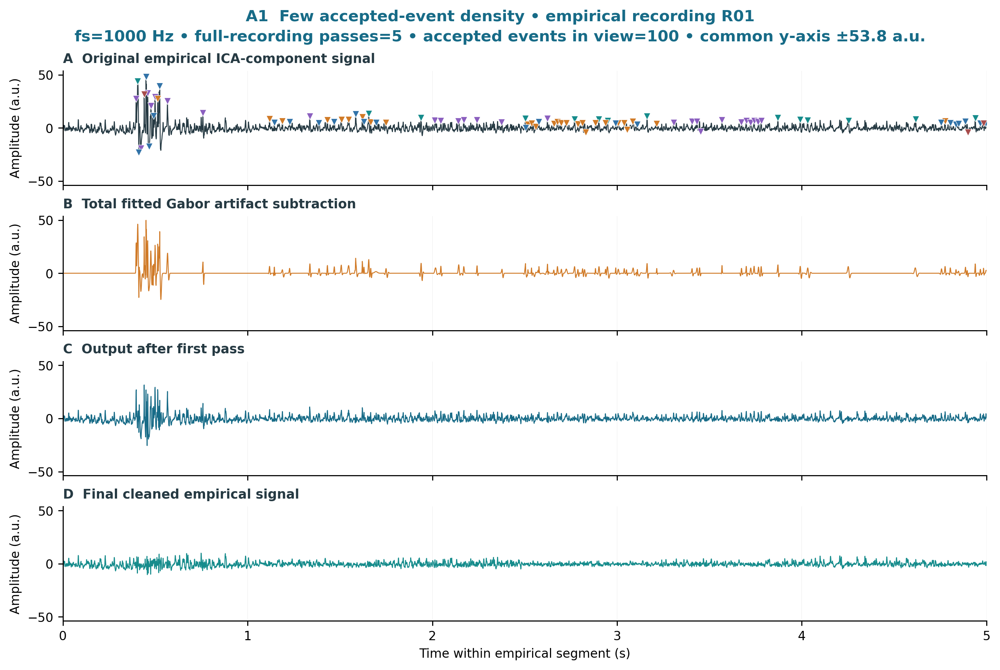
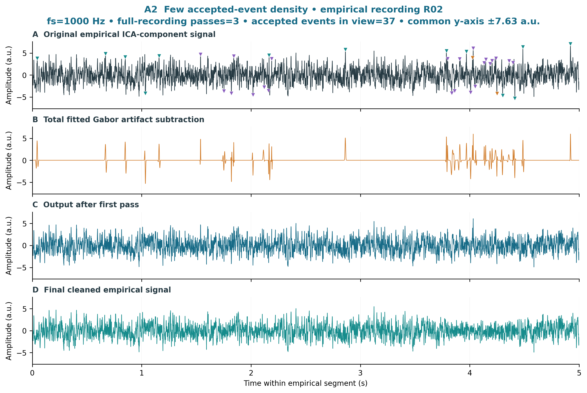
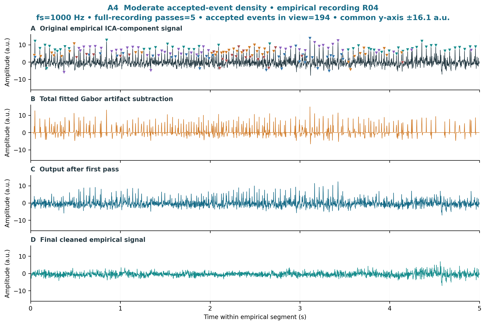
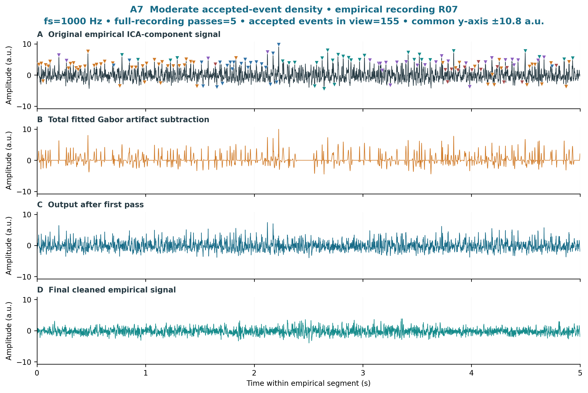
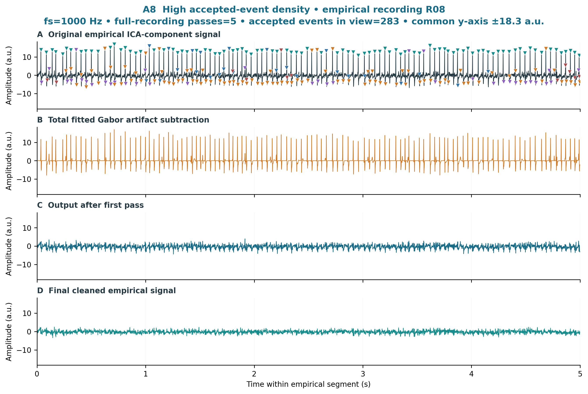
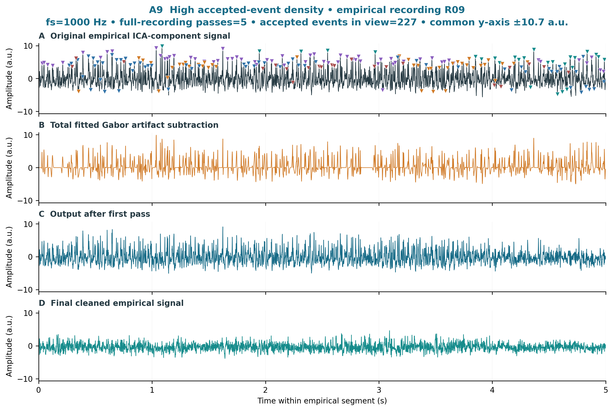

# Empirical EEG/ICA cleaning examples

The six scientific examples below are genuine, contiguous five-second
ICA-component intervals from the validated benchmark recordings. The frozen
native C++ cleaner was run on each complete 30-second recording before the
displayed interval was extracted, preserving the detector's continuous-recording
context.

Every figure shows the empirical input with genuine accepted-event markers,
cumulative fitted subtraction computed as `original - final cleaned`, the
first-pass output where informative, and the final cleaned signal. All panels in
an example use identical amplitude limits and span exactly 0–5 s. No waveform,
event, residual, or fitted curve was added, smoothed, retouched, or rescaled.

The established filenames are retained so existing documentation links remain
valid. Their contents are now the approved empirical A1, A2, A4, A7, A8 and A9
renderings. Original signals, numerical arrays, participant and source-recording
identifiers, source hashes, and event-level provenance remain outside this
repository.

## 1. Lower-density interval with a dominant burst

`single_isolated.png` now contains empirical example A1: a localized
high-amplitude burst followed by quieter activity.



## 2. Lower-density distributed activity

`multiple_separated.png` now contains empirical example A2: lower-amplitude
activity with scattered accepted transients.



## 3. Moderate-density activity

`closely_spaced.png` now contains empirical example A4: frequent narrow events
and changing background amplitude.



## 4. Moderate-density multi-pass behavior

`sampling_500_hz.png` now contains empirical example A7. It illustrates
irregular event amplitudes and the difference between the first-pass and final
five-pass result. The filename is retained only for link compatibility; the
empirical recording shown was sampled at 1000 Hz, as stated in the figure.



## 5. High-density activity

`dense_activity.png` now contains empirical example A8: sustained dense,
high-amplitude transient activity. It replaces the rejected periodic synthetic
train.



## 6. Heterogeneous high-density activity

`three_passes.png` now contains empirical example A9: dense activity with
substantial amplitude variation. The filename is retained only for link
compatibility; the figure reports the actual five full-recording passes.



Small residual spike-like components can remain after one pass. These may be
reduced by an additional pass when their morphology and selected parameters make
them eligible, but additional passes do not guarantee improvement.

## Synthetic numerical fixtures

Synthetic signals remain available strictly for reproducible interface and
regression testing:

```bash
PYTHONPATH=python python examples/generate_examples.py
```

The script writes clearly labelled outputs under
`examples/generated/synthetic_test_outputs/`, isolated from the approved
empirical PNG files. It cannot overwrite the public scientific examples. The
compact command-line example `gaborfit_clean_example` and
`examples/clean_synthetic.py` likewise remain API smoke tests without
scientific-performance claims.
